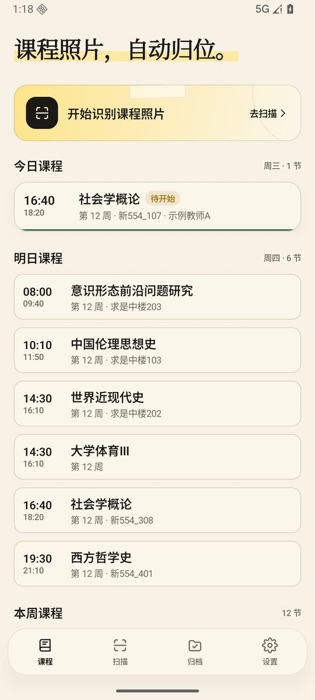
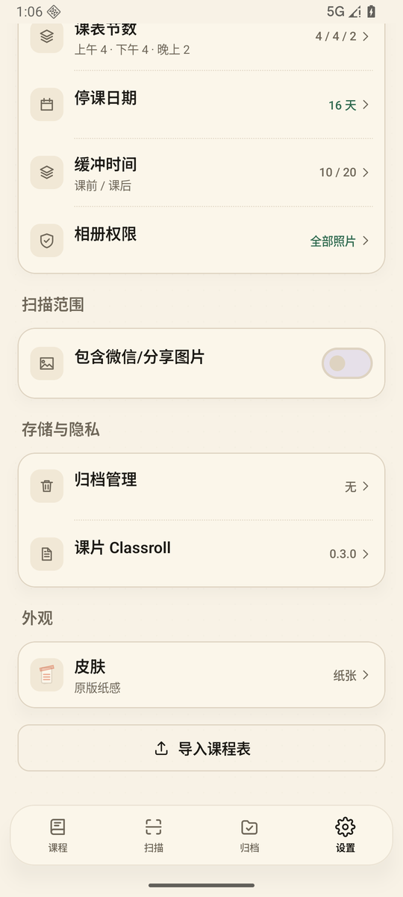

<p align="center">
  
</p>

<h1 align="center">课页 · Classroll</h1>

<p align="center"><strong>按课表，把课堂照片自动归位。</strong></p>

<p align="center">读取拍摄时间 · 对照课程表 · 人工确认后复制归档<br/>全本地处理 · 不联网 · 只复制不删除</p>

<p align="center">
  
  
  
  
  
</p>

<p align="center">
  <a href="#它解决什么问题">它解决什么问题</a> ·
  <a href="#快速开始">快速开始</a> ·
  <a href="#课表导入">课表导入</a> ·
  <a href="docs/schedule-adaptation.md">他校适配指南</a> ·
  <a href="#数据与隐私">数据与隐私</a>
</p>

<p align="center">
  
  
  
</p>

> **目前只适配河南师范大学的课表**：只有河南师大教务系统导出的 `.xls` 周课表可以直接导入。其他学校的格式不同，请看[他校课程表适配指南](docs/schedule-adaptation.md)，或者先把课表转成 JSON 再导入。

---

## 目录

- [它解决什么问题](#它解决什么问题)
- [功能](#功能)
- [工作流程](#工作流程)
- [快速开始](#快速开始)
- [课表导入](#课表导入)
- [换肤](#换肤)
- [数据与隐私](#数据与隐私)
- [项目结构](#项目结构)
- [开发与测试](#开发与测试)
- [已知限制](#已知限制)
- [参与贡献](#参与贡献)
- [许可证](#许可证)

---

## 它解决什么问题

一学期下来，相册里会堆几千张照片：课件、板书、课本、笔记，还有自拍、食堂和风景。期末想按课程找某一张，只能从头翻；手动建相册、一张张挪，更是不可能完成的任务。

课页把这件事改成：

1. 照片的拍摄时间本来就在系统相册索引里，一次查询就能全部拿到；
2. 课程表决定了每门课的上课时间段，落在时间段里的照片，大概率就是这门课的；
3. 再用本地的文字识别、屏幕特征和人脸检测，把明显的自拍和风景剔掉；
4. 剩下的按课程分组，你扫一眼、改几下勾选，确认归档。

整个过程不需要导出、不需要电脑、不会上传，原图也不会被移动或删除。

---

## 功能

| 能力 | 说明 |
| --- | --- |
| **按时间筛选** | 用课表生成每次课的时间窗（含课前 / 课后缓冲），只处理落在窗口内的照片 |
| **四档判定** | 结合中文 OCR、屏幕 / 投影特征、人脸占比，分为「像课件 / 存疑 / 边界 / 不像」，默认勾好像课件 |
| **人工确认** | 按「课程 → 第几次课」分组，支持批量勾选、单张剔除、跳过整组；中途退出会保存草稿 |
| **只复制归档** | 写入 `Pictures/课程归档/<学期>/<课程>/`，系统相册里每门课自动成一个相册 |
| **课表导入** | 河南师大教务 `.xls` 周课表（支持一格多课、单双周）；也支持 JSON v1 / v2 |
| **作息管理** | 多套作息按生效日期切换；节次时间、上午 / 下午 / 晚上分组都可编辑 |
| **停课与冲突** | 单日或区间停课不生成时间窗；课表时间冲突在导入时提示 |
| **双皮肤** | 原版「纸张」与几何风格「包豪斯」，设置内切换、重启保持 |
| **本地识别** | ML Kit 中文文字识别与人脸检测均在设备离线运行 |

---

## 工作流程

```text
课程表 (.xls / .json)
        │
        ▼
生成每门课每次课的时间窗（含缓冲）
        │
        ▼
查询系统相册索引 ── 拍摄时间落在窗口内 ──▶ 候选照片
        │
        ▼
本地识别：文字量 / 屏幕特征 / 人脸
        │
        ▼
四档分组 ── 人工确认与调整
        │
        ▼
复制到 Pictures/课程归档/<学期>/<课程>/
```

---

## 快速开始

### 环境

- JDK 17
- Android SDK 35（`local.properties` 里写 `sdk.dir=/path/to/Android/Sdk`）
- 最低运行 Android 10（API 29）

项目自带 Gradle Wrapper，不需要单独安装 Gradle。

```bash
git clone <本仓库地址> classroll
cd classroll

./gradlew :app:assembleDebug
# 产物：app/build/outputs/apk/debug/app-debug.apk

adb install -r app/build/outputs/apk/debug/app-debug.apk
```

### 第一次使用

1. **导入课表**：设置 → 课程与扫描 → 课程表，选择 `.xls` 或 `.json`；在预览页核对节次、周次和冲突后保存。
2. **核对作息**：`.xls` 不带每节课的上下课时间，导入时会沿用已保存的作息，第一次请到设置 → 作息时间里确认。
3. **扫描相册**：首页「开始识别课程照片」，授予照片权限。
4. **确认并归档**：按分组查看候选照片，调整勾选后完成。

> 首次全量扫描在万级照片上要跑一段时间（主要耗在 OCR），之后可以只扫增量。

---

## 课表导入

### 支持情况

| 来源 | 直接导入 | 说明 |
| --- | --- | --- |
| 河南师范大学教务导出 `.xls` 周课表 | 是 | 每格 `课程名[类型]/教师/周次-节次/教室`，支持一格两门课、单双周、调课空教室 |
| 课页 JSON v1 / v2 | 是 | 任何学校都可以先转成 JSON 再导入 |
| 其他学校 `.xls` | 否 | 结构不同，需按[适配指南](docs/schedule-adaptation.md)处理 |

### 关于其他学校

课页的 Excel 解析是按河南师大教务导出的固定结构写的：7 列一周、每 11 行一个周块、格子内固定四行。换成别的学校，行列分布、节次写法、周次写法通常都不一样，**不能保证识别正确**。

两条路：

1. **不改代码**：按[适配指南 · 路线 A](docs/schedule-adaptation.md#路线-a不改代码转成-json) 把课表转成 JSON v2，App 直接导入；
2. **改解析器**：按[适配指南 · 路线 B](docs/schedule-adaptation.md#路线-b为你的学校加-xls-适配) 新增一个解析分支，并补脱敏样例与单元测试。

### 作息与时间匹配

课表只描述「第几周、星期几、第几节」，照片匹配需要「第几节对应几点到几点」，这个时间来自**作息**，不来自 Excel：

- 支持多套作息，按 `effectiveFrom` 选择当前生效的一套，适合冬令时 / 夏令时切换；
- 一套作息覆盖不到的节次，那门课不会产生扫描时间窗；
- 「上午 / 下午 / 晚上各几节」只用于设置页分组展示，不参与匹配。

---

## 换肤

设置 → 外观 → 皮肤。两套皮肤共用同一套信息结构和交互，只换视觉：

| 纸张（默认） | 包豪斯 |
| --- | --- |
| 米色纸面、圆角卡片、柔和投影、虚线分隔 | 灰底、2dp 黑描边、直角、实心偏移硬投影 |
| 纸纹、和纸胶带、衬线标题 | 三原色、粗黑几何字体、几何色块 |

<p align="center">
  
  
</p>

包豪斯皮肤的配色与构成参考了 [Superdesign 的 Bauhaus 风格](https://superdesign.dev/library/bauhaus)，只借用视觉语言。切换结果存在本机 DataStore，重启后保持。

---

## 数据与隐私

- **没有账号、没有遥测、不联网**。文字识别和人脸检测都是 ML Kit 的本地离线模型。
- 照片只读取拍摄时间、缩略图和判定特征；不会上传，也不会改动原图。
- 归档 = 复制到 `Pictures/课程归档/`，删除原图不在本应用的范围内。
- 课表、扫描记录、归档索引保存在应用私有目录；卸载应用会丢失课表配置，但归档照片仍留在系统相册。
- 提交 Issue 前请先脱敏：不要附带真实姓名、学号和未打码的课表截图。

---

## 项目结构

```text
app/src/main/java/com/classroll/photo/
├── MainActivity.kt        单 Activity 入口，读取皮肤设置
├── data/                  课表 .xls / JSON 解析、归档索引、DataStore
├── model/                 课程表、照片、扫描状态模型
├── recognition/           OCR、人脸、屏幕特征、粗筛与分组
├── scan/                  扫描流程与 ViewModel
└── ui/
    ├── screens/           首页、扫描、确认、归档、课表、设置
    ├── theme/             双皮肤 token 与 Material 主题
    ├── Common.kt          卡片、按钮、分档条等共享组件
    └── SkinGlyph.kt       皮肤入口图标（纸张 / 四色方块）

app/src/test/              单元测试（含课表解析回归用例与脱敏样例）
docs/                      README 截图、他校课表适配指南
prototype/                 早期 HTML 交互原型
tools/                     识别规则评估与数据整理脚本（开发用）
```

---

## 开发与测试

```bash
./gradlew :app:testDebugUnitTest   # 全部单元测试
./gradlew :app:assembleDebug       # 构建 Debug APK
```

已有的回归用例覆盖：

- `.xls` 解析：多课同格、每周课、单双周、教室为空；
- 课表 JSON v1 / v2 解析与周次语法；
- 照片时间匹配、扫描记录、识别规则。

修改课表相关代码时，请同步更新 [`XlsScheduleParserTest.kt`](app/src/test/java/com/classroll/photo/XlsScheduleParserTest.kt)；样例使用脱敏后的 `app/src/test/resources/sample-timetable.xls`，**不要提交真实姓名和学号**。

---

## 已知限制

- `.xls` 直接导入只适配河南师范大学；其他学校请走 JSON 或适配解析器。
- 调课、临时停课不会自动识别：停课在设置里维护日期，调课靠确认页剔除。
- 排课冲突只提示，不会自动修改课表。
- 课程时间段之外拍的照片（补拍、翻拍）不会进入候选，需要手动处理。
- 目前只支持 Android；未适配平板横屏布局。

---

## 参与贡献

欢迎 Issue 和 PR。

1. 一个 PR 只做一件事；
2. 课表相关改动附脱敏样例和单元测试；
3. UI 改动附截图；
4. 不提交真实课表、照片、姓名、学号、构建产物。

如果是「我们学校导入失败」，提 Issue 时请附：学校名称、导出方式、脱敏后的表格结构（行列分布 + 一两个单元格原文）即可，不需要整份课表。

---

## 许可证

暂未选择开源许可证。在补充 `LICENSE` 之前，默认保留所有权利。

---

<p align="center">
  <sub>课页 · Classroll — 让每一张课堂照片回到它的课。</sub>
</p>
