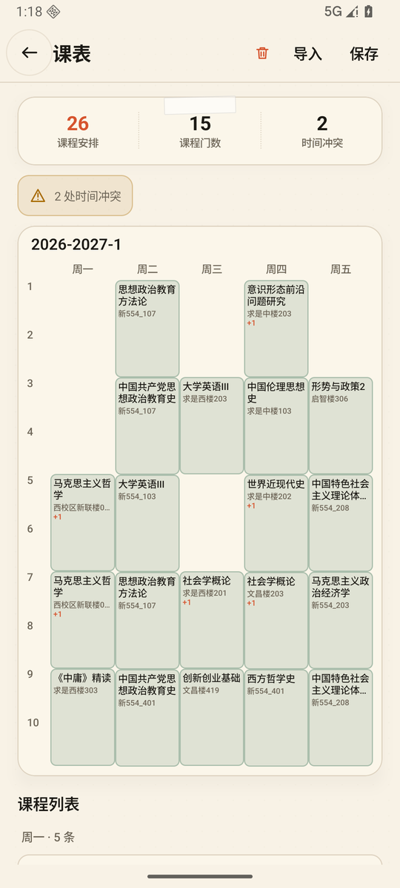
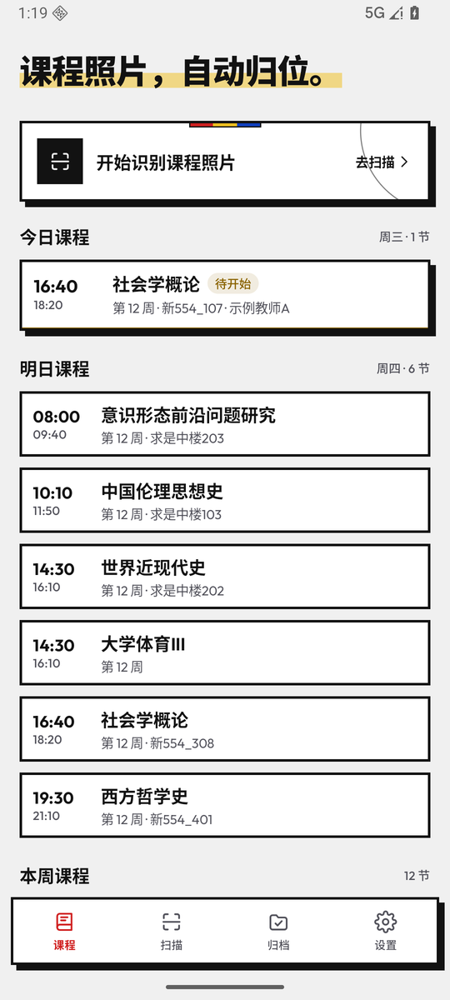
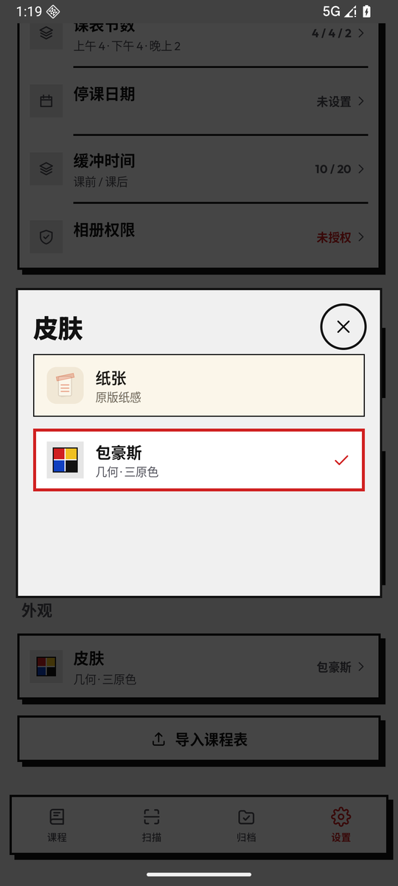

# 课页 Classroll

把课堂上拍的课件照片，按课程表自动归到对应的课程相册。

不需要导出、不需要电脑、不联网：课页直接读手机相册里照片的拍摄时间，对照你的课程表，把落在上课时间段里的照片筛出来，你扫一眼确认，再复制到 `Pictures/课程归档/<学期>/<课程>/`。原图不动。

<p align="center">
  
  
  
</p>

## 它能做什么

- **只按时间筛**：读系统相册索引里的拍摄时间，不用先把几万张照片拷出来。
- **自动分四档**：结合本地中文文字识别、屏幕/投影特征、人脸特征，把候选照片分成「像课件 / 存疑 / 边界 / 不像」，默认勾好像课件的那部分。
- **人工最终确认**：按「课程 → 第 N 次课」分组，支持批量勾选、单独剔除、跳过整组。
- **只复制，不移动、不删除**：归档写入 `Pictures/课程归档/`，系统相册里每门课自动出现一个相册。
- **课表直接导入**：支持教务系统导出的 `.xls` 周课表，也支持 JSON 课表（v1 / v2）。
- **两套皮肤**：原版「纸张」和几何风格的「包豪斯」，在设置 → 外观 → 皮肤切换，重启保持。

## 目前只适配河南师范大学的课表

**这是当前最重要的限制。**

课页的 `.xls` 导入是按河南师范大学教务系统导出的「周视图课表」写的：每 7 列对应一周（周一至周日），每个格子是 `课程名[类型] / 教师 / 周次-节次 / 教室` 四行，同一格可能叠放两门课。其他学校的教务系统导出格式一般不同，**目前不能直接导入**。

其他学校的适配方法见 [他校课程表适配指南](docs/schedule-adaptation.md)。如果暂时不想改代码，也可以先把课表转成 JSON v2（格式见同一篇文档），App 可以直接导入 JSON。

## 快速开始

环境：JDK 17、Android SDK 35。项目自带 Gradle Wrapper，无需另装 Gradle。

```bash
# 在 local.properties 里写 sdk.dir=/path/to/Android/Sdk
./gradlew :app:assembleDebug
# 产物：app/build/outputs/apk/debug/app-debug.apk

# 单元测试（含课表解析回归用例）
./gradlew :app:testDebugUnitTest
```

最低支持 Android 10（API 29）。

## 使用流程

1. **导入课表**：设置 → 课程与扫描 → 课程表，选择教务导出的 `.xls`（或 `.json`）。导入后会先进入预览页，确认周次、节次、冲突后再保存。
2. **补齐作息**：`.xls` 不带每节课的起止时间，导入时沿用已保存的作息；第一次使用请在设置 → 作息时间里核对。
3. **扫描相册**：首页「开始识别课程照片」，授权读取照片。
4. **确认**：按课程分组查看候选，调整勾选。
5. **归档**：完成后照片复制进系统相册的课程归档目录。

## 换肤

设置 → 外观 → 皮肤：

| 纸张（默认） | 包豪斯 |
| --- | --- |
| 米色纸面、圆角卡片、柔和投影、虚线分隔、衬线标题 | 灰底、2dp 黑描边、直角、实心偏移硬投影、三原色与粗黑几何字体 |

<p align="center">
  
  
</p>

包豪斯皮肤的配色与结构参考了 [Superdesign 的 Bauhaus 风格](https://superdesign.dev/library/bauhaus)，只借用视觉语言，交互与信息结构保持不变。

## 隐私

- 不联网、不上传、不依赖 Google 账号或云服务。
- 文字识别（ML Kit 中文）和人脸检测都在设备本地离线运行。
- 照片只读取拍摄时间与缩略图用于判定；归档是复制，不改动、不删除原图。
- 课表、扫描记录、归档索引都只存在本应用私有目录和系统相册里。

## 技术栈

- Kotlin + Jetpack Compose（Material 3），单 Activity。
- 识别：ML Kit 中文文字识别 + 人脸检测 + 自写的粗筛/版式规则（`recognition/`）。
- 课表：`jxl` 解析 `.xls`，JSON 走自写解析器；DataStore 持久化。
- 图片：Coil；EXIF：ExifInterface。

```
app/src/main/java/com/classroll/photo/
├── data/          # 课表解析、归档索引、设置存储
├── model/         # 课表与照片模型
├── recognition/   # OCR、人脸、粗筛、分组
├── scan/          # 扫描流程与 ViewModel
└── ui/
    ├── screens/   # 首页、扫描、确认、归档、课表、设置
    └── theme/     # 双皮肤 token（Skin.kt / Color.kt / Theme.kt）
docs/              # 截图与他校适配指南
prototype/         # 早期 HTML 交互原型
tools/             # 识别规则评估与数据整理脚本（开发用）
```

## 已知限制

- `.xls` 导入目前只适配河南师范大学的导出格式，其他学校请看适配指南。
- 调课、临时停课不会自动识别；停课日期在设置里手动维护，调课靠确认页剔除。
- 首次全量扫描在万级照片上需要较长时间，之后可只扫增量。
- 课表冲突检测只提示，不会自动改课表。

## 参与贡献

欢迎提交 Issue / PR。涉及课表的反馈请务必**脱敏**：不要附带真实姓名、学号；课表截图请打码，`.xls` 请先把标题和教师名替换成示例值。

## 许可证

暂未选择开源许可证。在补充 LICENSE 前，默认保留所有权利。
